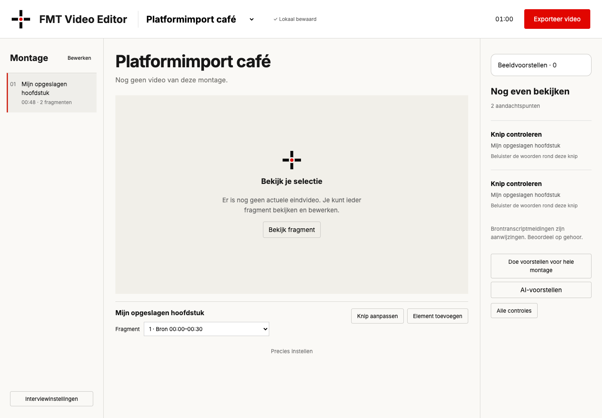

# Platformcontrole

## Getest op 2 november 2026

| Platform | Schone installatie | Softwaretests | Browserimport, bewaren/herstart, MP4 en thumbnail |
|---|---|---|---|
| macOS 14, ARM | Geslaagd | 275 geslaagd | Geslaagd |
| Windows Server 2022, x64 | Geslaagd | 275 geslaagd | Geslaagd |
| Ubuntu 24.04, x64 | Geslaagd | 275 geslaagd | Geslaagd |

Gebruikt: Node 22, Python 3.12, FFmpeg en Chrome. [De volledige matrix](https://github.com/erwinblom/fmt-video-editor/actions/runs/41519563569) bewijst de gebruikersroutes op alle drie systemen. Alleen de Windows-testopruiming had in die ronde nog een bestandsvergrendeling na een geslaagde exporttest. [De gerichte Windows-herproef](https://github.com/erwinblom/fmt-video-editor/actions/runs/41520512109) controleert de opgeloste testopruiming. De productcode is tussen deze runs ongewijzigd.

### Wat de proef werkelijk doet

- Installeert de vastgelegde Node- en Python-afhankelijkheden op elke runner en voert 275 softwaretests uit.
- Opent de editor in echte Chrome en importeert een gegenereerde opname via Interviewinstellingen → Nieuw interview → de bestandskiezer.
- Wijzigt een hoofdstuktitel via de lokale API, bewaart die op schijf, herlaadt de browser en herstart de server; de complete montage moet gelijk terugkomen.
- Exporteert zowel een demo met ondertitels als een nieuw handmatig geïmporteerd project via de lokale export-API. Beide MP4-bestanden worden buiten de editor volledig met FFmpeg gedecodeerd.
- Kiest en bewaart een thumbnail via de lokale API, controleert de JPEG en de afmetingen 1280 × 720.
- Start de server ook met de meegeleverde gezamenlijke startopdracht.

Dit combineert echte browserbediening met API-controles; niet iedere bewerking is met muisklikken uitgevoerd. De fictieve opname bevat geen echte spraak, dus deze proef beoordeelt geen transcriptie- of luisterkwaliteit. Er is geen proef met een beginnende gebruiker uitgevoerd, geen bewijs voor iedere Linux-distributie/Windows-desktopversie en geen claim over alle browsers.

*Gegenereerde proefopname, opgeslagen hoofdstuktitel en de normale controlepunten van de editor. Er staan geen persoonlijke interviews in de proef.*

## Zelf aanpassen met AI

Een onafhankelijke uitvoerder volgde de leesmij in een aparte bronkopie: rood werd blauw. De gewijzigde knop is in Chrome bekeken; ondertitels zijn via de interface gewijzigd, op schijf bewaard en na een volledige browserherstart teruggelezen. Afspelen bleef werken. Dit is een beperkte aanpasproef, geen nieuwe installatie- of exportproef en geen beginnerstest.

## Optionele AI en audiomastering

Handmatig monteren en lokale export vormen de platformbasis. De meegeleverde Desert Ant Swift-installer is specifiek voor macOS; gebruik hem niet op Windows/Linux. Whisper kan afzonderlijk voor je systeem worden geïnstalleerd; wijs het programma en model aan met FMT_WHISPER_BIN en FMT_WHISPER_MODEL. Whisper, Voz/Who, Eye, lokale taalmodellen, cloudfuncties en Auphonic hebben hun eigen vereisten en zijn geen onderdeel van deze platformproef. Lees MODELVOORWAARDEN.md voordat je een model kiest.

## Installatievorm

Het ZIP bevat broncode, afbeeldingen, fonts met licenties en start-/installatiebestanden. Node, Python, FFmpeg, Chrome, modelgewichten en persoonlijke gegevens worden niet gebundeld. Er wordt geen achtergrondservice geïnstalleerd. De bestaande Mac-appbouwer blijft optioneel beschikbaar met npm run app:mac. Bewaar je hele app/data-map afzonderlijk als back-up van je eigen projecten; GitHub bewaart die privégegevens niet.
