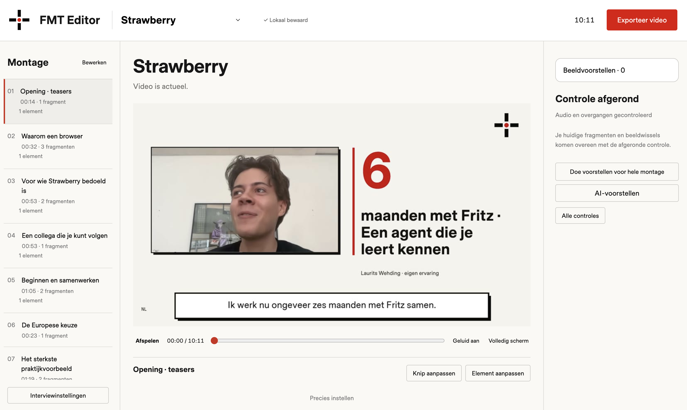

# FMT Video Editor

Een lokale editor voor interviews: knippen, ordenen, ondertitelen, video exporteren en een thumbnail maken. **De basis werkt zonder Desert Ant Labs, Auphonic of een cloudaccount.** Extra modellen kunnen werk versnellen; zij zijn geen voorwaarde om je opname te monteren.

Ik maakte dit met AI omdat ik het zelf nodig had. Ik ben geen programmeur en geen designer. Ik deel dit om te laten zien wat mogelijk is en je op gang te helpen. Gebruik het als vertrekpunt: bouw erop voort en maak het naar je eigen maat.

**Openbare proefversie voor macOS.** Een werkend vertrekpunt om zelf te gebruiken en verder te bouwen. Installeren vraagt de hulpmiddelen hieronder; een AI-assistent kan je daarbij helpen. De volledige installatie op een andere Mac en een proef met een beginnende gebruiker zijn nog niet gecontroleerd. Zie [wat is getest](PUBLICATIESTATUS.md).

[Download het bronpakket](https://github.com/erwinblom/fmt-video-editor/releases/download/v0.1.0-preview.1/FMT-Video-Editor-bron-v0-1-0-preview-1.zip) · [Alle downloads](https://github.com/erwinblom/fmt-video-editor/releases) · [Probleem melden](https://github.com/erwinblom/fmt-video-editor/issues)

*Praktijkvoorbeeld uit mijn eigen editor, met een gekozen FMT-vormgeving. De deelversie begint leeg en exporteert standaard zonder merk; bij Eigen stijl stel je je eigen naam en logo in. Het getoonde interview wordt niet meegeleverd.*

## Wat je nodig hebt

Een Mac met Node.js 22.16 of nieuwer, Python 3.11 of nieuwer, FFmpeg/ffprobe en Chrome of Chromium voor het renderen van de kaarten. De installatie haalt Node- en Python-pakketten op. Modelgewichten, eigen video's en accounts zitten niet in het bronpakket. De eerste installatie vraagt internet; de basisverwerking werkt daarna lokaal. Andere platformen zijn niet als complete editor getest.

## Installeren en beginnen

1. Pak het complete bronpakket uit in een eigen map. Gebruik niet de map van een bestaande persoonlijke editor.
2. Open `Installeer FMT Video Editor.command`. Als macOS het openen tegenhoudt, kies via rechtsklik Open of voer met hulp van je AI-assistent `zsh scripts/install-local.sh` uit in deze map. Lees een foutmelding; schakel systeembeveiliging niet breed uit.
3. Open `Start FMT Video Editor.command`. De editor gebruikt http://localhost:4319 en een eigen gegevensmap.
4. Voor een proef zonder eigen opname: voer `npm run demo` uit in de projectmap en herlaad de editor. Dit maakt uitsluitend een fictieve stille video. Het vervangt geen bestaand project.

`node scripts/check-installation.mjs` controleert de basisvoorzieningen. De installatie maakt ook een lokale startapp; deze opdracht installeert geen achtergrondservice. Bij voorkeur begin je in de browser.

## Eerste resultaat zonder extra diensten

1. Voeg een video of audio-opname toe. Kies bij **Werkwijze → Zelf monteren — zonder AI of diensten**.
2. De editor maakt werkfragmenten van maximaal dertig seconden in bronvolgorde. Dit zijn geen voorgestelde goede knippen en geen transcript. Beluister de opname en pas begin, einde en volgorde zelf aan. Er is geen sprekerherkenning of inhoudelijke selectie geclaimd.
3. Bewaar gewenste ondertitels per fragment door de tekst zelf in te voeren. Bij deze basisroute staan ondertitels in de video aanvankelijk uit. Zet bij **Exporteer video → Ondertitels in de video opnemen** de uitvoer aan zodra de geselecteerde fragmenten tekst hebben. Zonder ondertitels kun je gewoon exporteren.
4. Controleer de montage zelf met de bron. Bevestig de handmatige controle pas nadat je daadwerkelijk hebt gekeken en geluisterd. De stille demo bewijst geen spraak- of knipkwaliteit.
5. Kies **Exporteer video → Maak eindmontage**. De basis maakt lokaal een MP4 en, indien ingevuld, ondertitelbestand. Download de uitvoer en open die buiten de editor. De editor doet geen upload naar YouTube.

Wijzigingen worden bij het interview bewaard. Sluit en heropen om je montage terug te vinden. Bewaar de hele `app/data/`-map van deze installatie als je projecten wilt behouden of verplaatsen; die bevat bronmedia, montages en ondersteunende bestanden. Verplaats geen gegevens uit een andere editor over deze map heen.

## Thumbnail en eigen stijl

Open **Exporteer video → YouTube-thumbnail**. Kies een tijdstip in seconden en **Gebruik dit bronbeeld**. Voeg een korte titel toe, kies **Bewaar thumbnail** en download de JPG van 1280 × 720. Het beeld gebruikt het opgeslagen ruime gastkader of anders het volledige bronbeeld. Beeldkeuze en titel blijven bewaard.

Bij **Interviewinstellingen → Eigen stijl** kun je een eigen naam, website en logo bewaren of weer leegmaken. Kaarten gebruiken deze eigen stijl; de thumbnail neemt het gekozen logo over. Standaard is de uitvoer merkloos. Na een stijlwijziging bewaar je de thumbnail opnieuw. De FMT-naam en het icoon blijven bij het gereedschap zelf.

## Beter met optionele hulpmiddelen

| Aanvulling | Wat je erbij krijgt | Wat zonder deze aanvulling blijft werken |
|---|---|---|
| Whisper, lokaal | Automatisch brontranscript met segmenttijdcodes | Handmatig monteren en ondertitelen |
| Voz en Who, Desert Ant Labs | Lokaal transcript en automatisch onderscheid tussen stemmen | Basisimport, montage en export |
| Eye, Desert Ant Labs | Maximaal drie beeldvoorstellen uit tachtig onderzochte momenten | Een bronbeeld zelf kiezen en een thumbnail maken |
| Auphonic | Optionele audiomastering | Lokale audiomix en MP4-export |
| Eigen analyse-/taalmodel of gekozen cloudmodel | Voorstellen voor verhaallijn, ondertitels en beeldelementen | Zelf selecteren, tekst invoeren en vormgeven |

Whisper: installeer whisper.cpp/`whisper-cli` voor je platform en download het vastgelegde model via `zsh scripts/setup-whisper-model.sh`. Wijs een afwijkend programma of model aan met `FMT_WHISPER_BIN` en `FMT_WHISPER_MODEL` in `.fmt-local.json`. Kies daarna **Whisper** bij import. Segmenttijden zijn geen exact bewezen woordgrenzen. Deze route vereist geen Desert Ant of Auphonic.

Desert Ant: lees eerst MODELVOORWAARDEN.md. Modelgebruik vraagt modeldownloads en licentie-/gebruikstelemetrie. De kandidaat weigert SDK-start zolang `FMT_ALLOW_LICENSE_NETWORK` niet bewust op `1` staat in `.fmt-local.json`. Dat blokkeert de SDK vóór starten; de telemetrie wordt niet in de SDK uitgeschakeld. Voz/Who hebben aparte installatie via `scripts/setup-desert-ant.sh`; Eye is een optionele Node-dependency en downloadt zijn model pas bij gebruik. De video en beelden worden lokaal verwerkt. Modelkeuze is geen kwaliteitsgarantie: beoordeel de uitkomst.

Cloud staat standaard uit met `FMT_ALLOW_CLOUD=0`. Alleen wanneer je zelf cloudfuncties wilt gebruiken, stel je je eigen verbinding en sleutels in volgens PRIVACY.md. Er worden geen makersaccounts of tegoeden meegeleverd. Auphonic is aanvullend: lokale export moet ook blijven werken wanneer de dienst niet is geïnstalleerd, geen account heeft of faalt. Auphonic vraagt daarnaast de expliciete keuze `FMT_AUDIO_MASTERING=auphonic`; de standaard is `local`. Bij een fout blijft de lokale mix beschikbaar en meldt de export de terugval. Cloud inschakelen voor tekst activeert dus niet automatisch audiomastering.

## Begeleidend: de interviewskill

In `skills/fmt-interview-video/SKILL.md` staat de werkwijze voor een AI-assistent: bronvaste selectie, expliciete redactionele keuzes, menselijke luistercontrole, export en thumbnail. Geef je AI-assistent het bronpakket en vraag hem deze skill te gebruiken. In een omgeving met skillondersteuning kun je de complete map `fmt-interview-video` als skill installeren; een gewone chat kan de tekst als werkinstructie lezen. De skill installeert geen editor, modellen of accounts en verleent geen publicatietoestemming.

## Aanpassen met ChatGPT of Claude

Maak eerst een kopie van het volledige uitgepakte bronpakket. Open die map in je lokale AI-werkomgeving, of geef het bronpakket aan een nieuwe chat. Een gewone chat kan lokale bestanden niet vanzelf wijzigen. Begin met één kleine wens en test de kopie.

> Dit is het bronpakket van FMT Video Editor. Lees README.md en de relevante bestanden. Mijn eerste wens is: [één concrete wijziging]. Werk in een aparte kopie. Behoud de bestaande functies, mijn gegevens, licenties en de zelfstandige basis zonder externe diensten. Bouw of start de gewijzigde kopie, doorloop bewaren/heropenen en controleer de uitvoer. Publiceer of verstuur niets. Vertel wat je echt hebt getest en wat nog openstaat.

Geen bruikbare download uit je chat? Vraag voor een kleine wijziging om de exacte bestandsnaam en welke tekst je moet vervangen. Deel nooit eigen interviews, sleutels of privégegevens als dat niet nodig is. Meld een reproduceerbaar probleem via [GitHub Issues](https://github.com/erwinblom/fmt-video-editor/issues). Er wordt geen supportdienst beloofd.

## Als iets niet werkt

- Ontbrekende basisvoorziening: start `Controleer deze Mac.command` en geef de volledige foutmelding aan je AI-assistent, zonder sleutels of privé-inhoud.
- Geen extra model geïnstalleerd: kies **Zelf monteren**. Een bewaarde opname hoeft niet opnieuw te worden aangemaakt.
- Cloud- of modeltoestemming geweigerd: blijf in de basisroute, of lees eerst de voorwaarden en stel daarna bewust de gewenste aanvulling in.
- Export gewijzigd of verouderd: maak na de relevante montage- of stijlwijziging een nieuwe uitvoer. Een oude download verandert niet vanzelf.

## Vrijheid, privacy en controles

Eigen code en technische documentatie: MIT, zie LICENSE. FMT-naam en logo: afzonderlijk MERKVOORWAARDEN.md. Fonts, HyperFrames, GSAP en alle overige onderdelen houden hun eigen voorwaarden. Desert Ant is geen onderdeel dat wij onder MIT herlicentiëren. Zie THIRD_PARTY_NOTICES.md, MODELVOORWAARDEN.md en PRIVACY.md. Je hoeft eigen aanpassingen niet terug te leveren.

`npm test` test de software. `npm run source:check` controleert de bestandslijst, bronhashes en mogelijke geheimen in het gedownloade pakket, ook zonder Git. Na eigen wijzigingen zullen hashes afwijken; gebruik dan de softwaretests en controleer de gebruikersroute. `candidate:check` is alleen voor de oorspronkelijke lokale publicatiekandidaat zonder remote. `release:check` blijft geblokkeerd voor een stabiele volledige uitgave zolang de andere-Mac- en beginnersproeven openstaan. De openbare proefversie is uitsluitend een bronuitgave, zonder meegeleverde runtimes of modelgewichten.

Het screenshot is een gebruiksvoorbeeld en valt niet onder de MIT-codelicentie; zie [screenshot en rechten](docs/SCREENSHOT.md). Alleen bewezen controles staan in PUBLICATIESTATUS.md.
