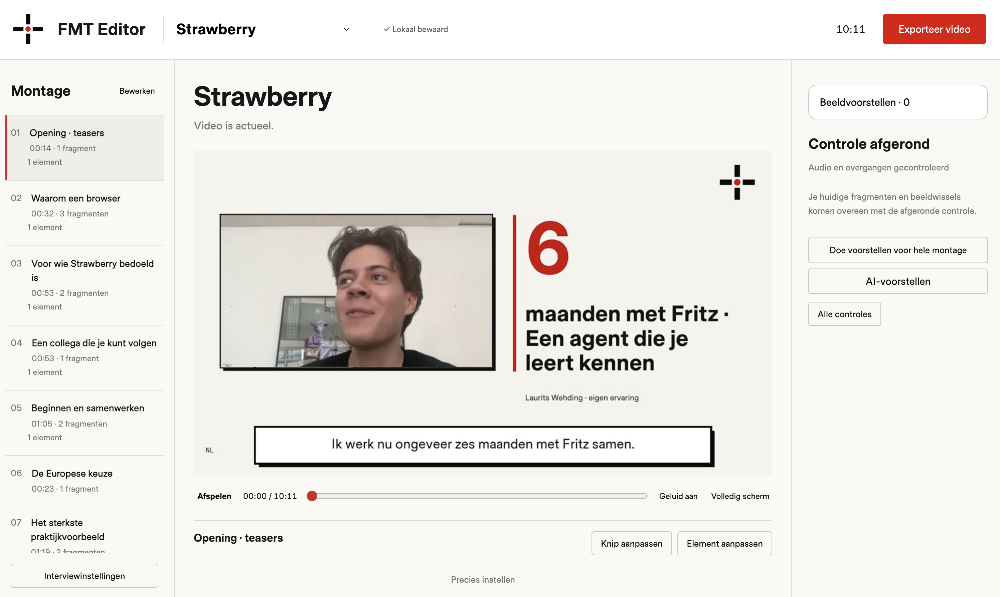

# FMT Video Editor

Een lokale editor voor interviews: knippen, ordenen, ondertitelen, video exporteren en een thumbnail maken. **De basis werkt zonder Desert Ant Labs, Auphonic of een cloudaccount.** Extra modellen kunnen werk versnellen; zij zijn geen voorwaarde om je opname te monteren.

Ik maakte dit met AI omdat ik het zelf nodig had. Ik ben geen programmeur en geen designer. Ik deel dit om te laten zien wat mogelijk is en je op gang te helpen. Gebruik het als vertrekpunt: bouw erop voort en maak het naar je eigen maat.

**Lokale video-editor voor Mac, Windows en Linux.** Je werkt in je browser; video’s en montages blijven in de map van de editor op je eigen computer. Dit is een bronuitgave: je installeert eerst de hulpmiddelen hieronder. De [platformcontrole](PLATFORM.md) beschrijft precies welke routes zijn getest.

[Download de nieuwste uitgave](https://github.com/erwinblom/fmt-video-editor/releases/latest) · [Probleem melden](https://github.com/erwinblom/fmt-video-editor/issues)

*Een echt gebruiksvoorbeeld uit mijn eigen editor. Het interview wordt niet meegeleverd. Jouw nieuwe installatie begint leeg; je kunt ook een fictieve demo proberen.*

## Wat je ermee kunt

- Video of audio importeren, fragmenten knippen en de volgorde veranderen.
- Ondertitels zelf schrijven, de montage controleren en een MP4 bewaren.
- Een beeld uit de opname kiezen en er een YouTube-thumbnail van maken.
- Met **Eigen stijl** je eigen naam, logo en website gebruiken. Zonder instellingen blijft je uitvoer merkloos.

## Wat je nodig hebt

Installeer [Node.js LTS](https://nodejs.org/en/download) (22.16 of nieuwer), [Python](https://www.python.org/downloads/) (3.11 of nieuwer), [FFmpeg met ffprobe](https://ffmpeg.org/download.html) en [Google Chrome](https://www.google.com/chrome/) of Chromium. Bij Python op Windows vink je **Add Python to PATH** aan. FFmpeg en ffprobe moeten vanuit een terminal bereikbaar zijn. Op Ubuntu kun je Python, venv en FFmpeg installeren met `sudo apt install python3 python3-venv ffmpeg`; op een Mac met Homebrew met `brew install python ffmpeg`.

De eerste installatie haalt softwarepakketten op en vraagt internet. Handmatig monteren en exporteren werken daarna lokaal, zonder AI-account of betaalde dienst. Je hebt voldoende vrije schijfruimte nodig voor bronvideo’s, werkbestanden en exports; een lange opname kan meerdere gigabytes vragen.

## Installeren en beginnen

1. Download het bron-ZIP bij de nieuwste uitgave en pak het volledig uit in een eigen map. Gebruik voor een nieuwe versie een nieuwe map; overschrijf je bestaande projecten niet.
2. Open het installatiebestand voor jouw systeem:

   | Systeem | Eenmalig installeren | Daarna starten |
   |---|---|---|
   | Mac | `Installeer FMT Video Editor.command` | `Start FMT Video Editor.command` |
   | Windows | `Installeer FMT Video Editor.bat` | `Start FMT Video Editor.bat` |
   | Linux | `sh "Installeer FMT Video Editor.sh"` | `sh "Start FMT Video Editor.sh"` |

   Op Linux voer je de opdracht uit in een terminal in de uitgepakte map. Op alle drie systemen werkt ook `node scripts/install.mjs`, gevolgd door `node scripts/start.mjs`.
3. De editor opent op **http://localhost:4319**. Houd het terminalvenster open tijdens gebruik. Open de link zelf als je browser niet vanzelf verschijnt. Stop de editor met **Ctrl+C** in het terminalvenster.
4. Kies een eigen opname. Liever eerst oefenen? Voer in de projectmap `npm run demo` uit voordat je start. Dit maakt een fictieve stille video en vervangt geen bestaand werk.

Als je systeem een gedownload script tegenhoudt, lees de melding en gebruik desgewenst de Node-opdrachten hierboven. Schakel geen algemene beveiliging uit. `node scripts/check-installation.mjs` vertelt welk hulpmiddel eventueel ontbreekt.

## Eerste resultaat zonder extra diensten

1. Voeg een video of audio-opname toe. Kies bij **Werkwijze → Zelf monteren — zonder AI of diensten**.
2. De editor maakt werkfragmenten van maximaal dertig seconden in bronvolgorde. Dit zijn geen voorgestelde goede knippen en geen transcript. Beluister de opname en pas begin, einde en volgorde zelf aan. Er is geen sprekerherkenning of inhoudelijke selectie geclaimd.
3. Bewaar gewenste ondertitels per fragment door de tekst zelf in te voeren. Bij deze basisroute staan ondertitels in de video aanvankelijk uit. Zet bij **Exporteer video → Ondertitels in de video opnemen** de uitvoer aan zodra de geselecteerde fragmenten tekst hebben. Zonder ondertitels kun je gewoon exporteren.
4. Controleer de montage zelf met de bron. Bevestig de handmatige controle pas nadat je daadwerkelijk hebt gekeken en geluisterd. De stille demo bewijst geen spraak- of knipkwaliteit.
5. Kies **Exporteer video → Maak eindmontage**. De basis maakt lokaal een MP4 en, indien ingevuld, ondertitelbestand. Download de uitvoer en open die buiten de editor. De editor doet geen upload naar YouTube.

Wijzigingen worden bij het interview bewaard. Sluit en heropen om je montage terug te vinden. Bewaar de hele `app/data/`-map van deze installatie als je projecten wilt behouden of verplaatsen; die bevat bronmedia, montages en ondersteunende bestanden. Verplaats geen gegevens uit een andere editor over deze map heen.

## Thumbnail en eigen stijl

Open **Exporteer video → YouTube-thumbnail**. Kies een tijdstip in seconden en **Gebruik dit bronbeeld**. Voeg een korte titel toe, kies **Bewaar thumbnail** en download de JPG van 1280 × 720. Het beeld gebruikt het opgeslagen ruime gastkader of anders het volledige bronbeeld. Beeldkeuze en titel blijven bewaard.

Bij **Interviewinstellingen → Eigen stijl** kun je een eigen naam, website en logo bewaren of weer leegmaken. Kaarten gebruiken deze eigen stijl; de thumbnail neemt het gekozen logo over. Standaard is de uitvoer merkloos. Na een stijlwijziging bewaar je de thumbnail opnieuw. De FMT-naam en het icoon blijven bij het gereedschap zelf.

## Beter met optionele hulpmiddelen

| Aanvulling | Wat je erbij krijgt | Wat zonder deze aanvulling blijft werken |
|---|---|---|
| Whisper, lokaal | Automatisch brontranscript met segmenttijdcodes | Handmatig monteren en ondertitelen |
| Voz en Who, Desert Ant Labs | Lokaal transcript en automatisch onderscheid tussen stemmen | Basisimport, montage en export |
| Eye, Desert Ant Labs | Maximaal drie beeldvoorstellen uit tachtig onderzochte momenten | Een bronbeeld zelf kiezen en een thumbnail maken |
| Auphonic | Optionele audiomastering | Lokale audiomix en MP4-export |
| Eigen analyse-/taalmodel of gekozen cloudmodel | Voorstellen voor verhaallijn, ondertitels en beeldelementen | Zelf selecteren, tekst invoeren en vormgeven |

Whisper: installeer whisper.cpp/`whisper-cli` voor je platform en download het vastgelegde model via `zsh scripts/setup-whisper-model.sh`. Wijs een afwijkend programma of model aan met `FMT_WHISPER_BIN` en `FMT_WHISPER_MODEL` in `.fmt-local.json`. Kies daarna **Whisper** bij import. Segmenttijden zijn geen exact bewezen woordgrenzen. Deze route vereist geen Desert Ant of Auphonic.

Desert Ant: lees eerst MODELVOORWAARDEN.md. Modelgebruik vraagt modeldownloads en licentie-/gebruikstelemetrie. De kandidaat weigert SDK-start zolang `FMT_ALLOW_LICENSE_NETWORK` niet bewust op `1` staat in `.fmt-local.json`. Dat blokkeert de SDK vóór starten; de telemetrie wordt niet in de SDK uitgeschakeld. Voz/Who hebben aparte installatie via `scripts/setup-desert-ant.sh`; Eye is een optionele Node-dependency en downloadt zijn model pas bij gebruik. De video en beelden worden lokaal verwerkt. Modelkeuze is geen kwaliteitsgarantie: beoordeel de uitkomst.

Cloud staat standaard uit met `FMT_ALLOW_CLOUD=0`. Alleen wanneer je zelf cloudfuncties wilt gebruiken, stel je je eigen verbinding en sleutels in volgens PRIVACY.md. Er worden geen makersaccounts of tegoeden meegeleverd. Auphonic is aanvullend: lokale export moet ook blijven werken wanneer de dienst niet is geïnstalleerd, geen account heeft of faalt. Auphonic vraagt daarnaast de expliciete keuze `FMT_AUDIO_MASTERING=auphonic`; de standaard is `local`. Bij een fout blijft de lokale mix beschikbaar en meldt de export de terugval. Cloud inschakelen voor tekst activeert dus niet automatisch audiomastering.

## Begeleidend: de interviewskill

In `skills/fmt-interview-video/SKILL.md` staat de werkwijze voor een AI-assistent: bronvaste selectie, expliciete redactionele keuzes, menselijke luistercontrole, export en thumbnail. Geef je AI-assistent het bronpakket en vraag hem deze skill te gebruiken. In een omgeving met skillondersteuning kun je de complete map `fmt-interview-video` als skill installeren; een gewone chat kan de tekst als werkinstructie lezen. De skill installeert geen editor, modellen of accounts en verleent geen publicatietoestemming.

## Zo pas je Video Editor aan

Je hoeft geen programmeur te zijn om een eerste eigen aanpassing te proberen. Begin bijvoorbeeld met grotere knoppen, andere kleuren of een andere standaardtitel.

1. Maak een kopie van het volledige uitgepakte bronpakket. Bewaar je werkende versie.
2. Open de kopie in Codex, Claude Code of een andere AI-werkomgeving. Bij een gewone ChatGPT- of Claude-chat voeg je het bronpakket toe; zo’n chat kan je computer niet vanzelf veranderen.
3. Geef één concrete wens en noem je systeem: Mac, Windows of Linux. Gebruik de voorbeeldopdracht hieronder.
4. Laat de AI de gewijzigde versie starten. Controleer met een proefopname of openen, bewaren, heropenen en exporteren nog werken.
5. Tevreden? Gebruik je aangepaste kopie. Je hoeft je wijziging niet naar mij terug te sturen.

Deel de software met de AI, geen privé-interviews, persoonlijke instellingen of sleutels.

> Dit is het bronpakket van FMT Video Editor. Lees README.md en de relevante bestanden. Mijn eerste wens is: [één concrete wijziging]. Werk in een aparte kopie. Behoud de bestaande functies, mijn gegevens, licenties en de zelfstandige basis zonder externe diensten. Bouw of start de gewijzigde kopie, doorloop bewaren/heropenen en controleer de uitvoer. Publiceer of verstuur niets. Vertel wat je echt hebt getest en wat nog openstaat.

Geen bruikbare download uit je chat? Vraag voor een kleine wijziging om de exacte bestandsnaam en welke tekst je moet vervangen. Deel nooit eigen interviews, sleutels of privégegevens als dat niet nodig is. Meld een reproduceerbaar probleem via [GitHub Issues](https://github.com/erwinblom/fmt-video-editor/issues). Er wordt geen supportdienst beloofd.

## Als iets niet werkt

- Ontbrekende basisvoorziening: voer `node scripts/check-installation.mjs` uit en geef de volledige foutmelding aan je AI-assistent, zonder sleutels of privé-inhoud.
- Geen extra model geïnstalleerd: kies **Zelf monteren**. Een bewaarde opname hoeft niet opnieuw te worden aangemaakt.
- Cloud- of modeltoestemming geweigerd: blijf in de basisroute, of lees eerst de voorwaarden en stel daarna bewust de gewenste aanvulling in.
- Export gewijzigd of verouderd: maak na de relevante montage- of stijlwijziging een nieuwe uitvoer. Een oude download verandert niet vanzelf.

## Vrijheid, privacy en controles

Eigen code en technische documentatie: MIT, zie LICENSE. FMT-naam en logo: afzonderlijk MERKVOORWAARDEN.md. Fonts, HyperFrames, GSAP en alle overige onderdelen houden hun eigen voorwaarden. Desert Ant is geen onderdeel dat wij onder MIT herlicentiëren. Zie THIRD_PARTY_NOTICES.md, MODELVOORWAARDEN.md en PRIVACY.md. Je hoeft eigen aanpassingen niet terug te leveren.

`npm test` test de software. `npm run source:check` controleert de bestandslijst, bronhashes en mogelijke geheimen in het gedownloade pakket, ook zonder Git. Na eigen wijzigingen zullen hashes afwijken; gebruik dan de softwaretests en controleer de gebruikersroute. `candidate:check` controleert de geschiedenis en de vaste openbare repository. `release:check` blijft geblokkeerd voor een stabiele volledige uitgave zolang de volledige beginners- en aanvullende modelproeven openstaan. De openbare proefversie is uitsluitend een bronuitgave, zonder meegeleverde runtimes of modelgewichten.

Het screenshot is een gebruiksvoorbeeld en valt niet onder de MIT-codelicentie; zie [screenshot en rechten](docs/SCREENSHOT.md). Alleen bewezen controles staan in PUBLICATIESTATUS.md.
